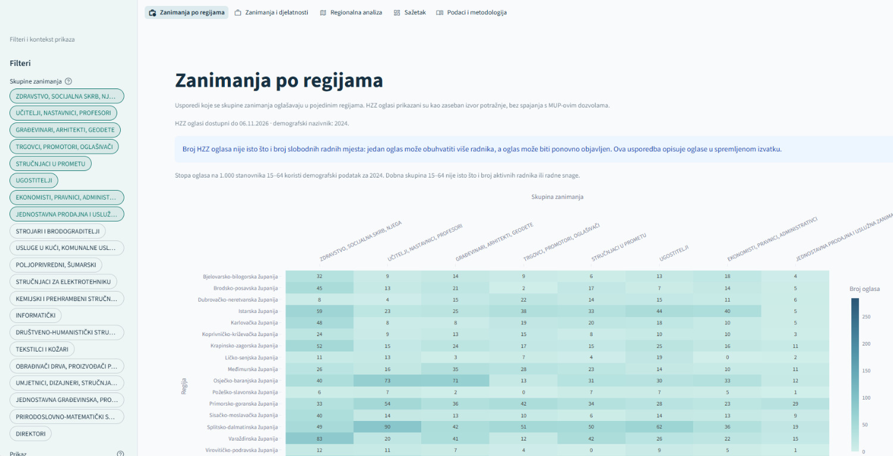
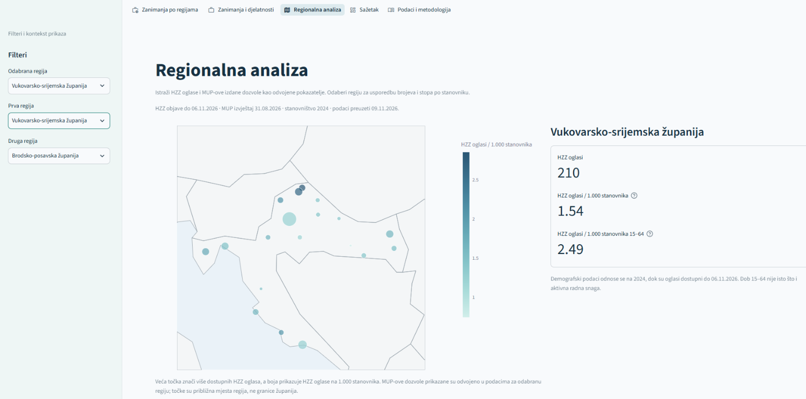
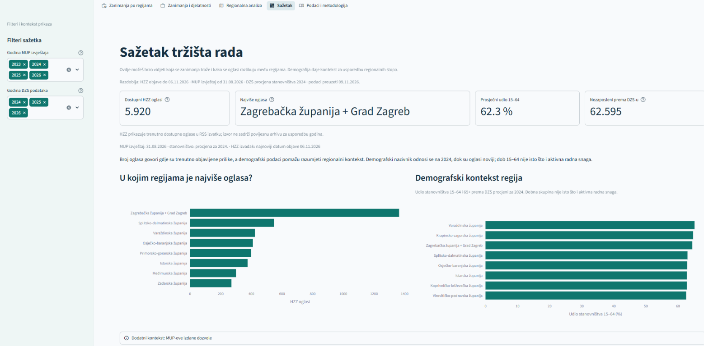
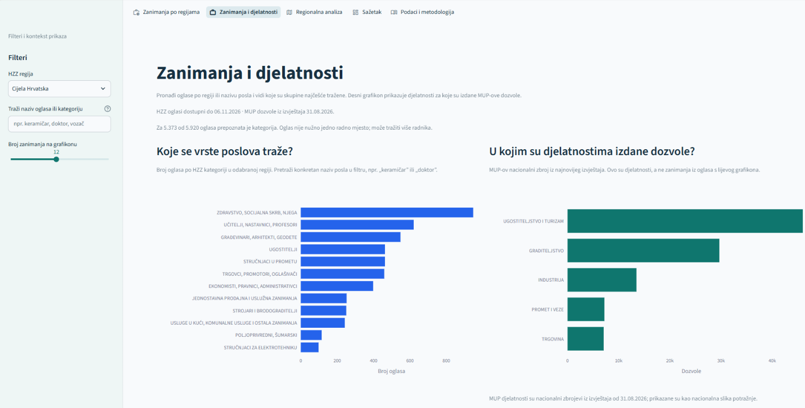
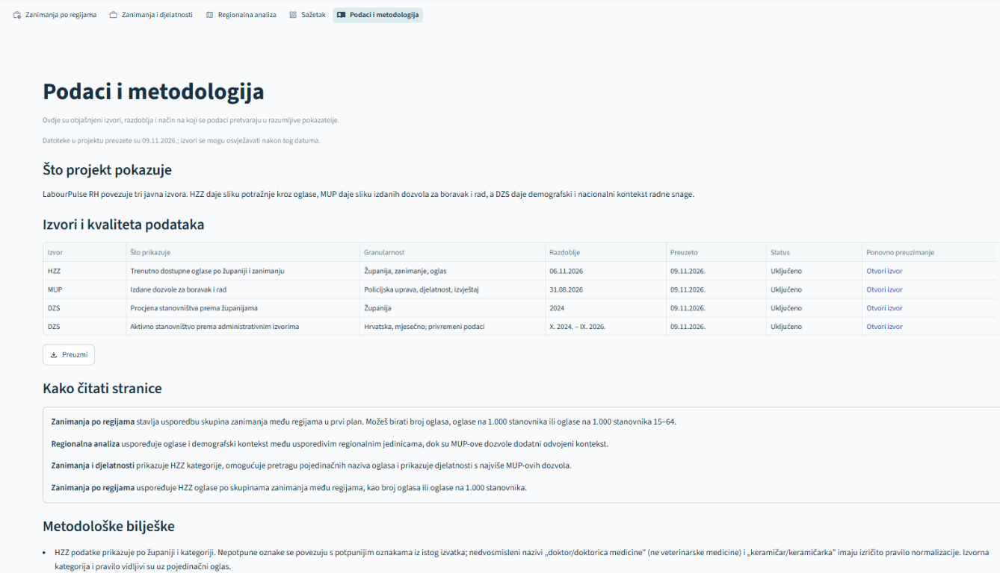

# LabourPulse RH

## Što je LabourPulse RH?

LabourPulse RH je interaktivni pregled hrvatskog tržišta rada koji iz javno
dostupnih podataka pokazuje:

- koja se zanimanja najviše oglašavaju,
- kako se potražnja razlikuje među regijama,
- kako izgleda demografski kontekst regija,
- koje su djelatnosti obuhvaćene izdanim MUP-ovim dozvolama za boravak i rad.

Projekt je namijenjen građanima, poslodavcima, lokalnoj upravi, obrazovnim
ustanovama i svima koji žele jednostavnije razumjeti regionalne potrebe za
radnicima.

> **Važno:** LabourPulse RH ne računa jedan zajednički „indeks pritiska”.
> HZZ oglasi, demografija i MUP-ove dozvole prikazani su odvojeno kako se
> različiti pokazatelji ne bi pogrešno tumačili kao ista pojava.

## Brzi pregled aplikacije

### Zanimanja po regijama

Početna stranica stavlja zanimanja u prvi plan. Skupine zanimanja mogu se
usporediti kao ukupan broj oglasa, broj oglasa na 1.000 stanovnika ili broj
oglasa na 1.000 stanovnika u dobi 15–64.



### Regionalna analiza

Ova stranica uspoređuje regije, prikazuje demografski pregled stanovništva
15–64 i 65+ te zasebno daje MUP-ov kontekst. Demografski nazivnik odnosi se na
2024., dok su HZZ oglasi noviji.



### Sažetak

Sažetak daje brzi pregled ukupnog broja oglasa, regije s najviše oglasa,
demografskog konteksta i dostupnih vremenskih razdoblja podataka.



### Zanimanja i djelatnosti

Ovdje se mogu pretražiti nazivi oglasa i HZZ kategorije, a zasebno se prikazuju
djelatnosti u kojima su izdane MUP-ove dozvole. Zanimanja i djelatnosti nisu
ista klasifikacija.



### Podaci i metodologija

Metodološka stranica objašnjava izvore, način obrade, ograničenja i značenje
svakog pokazatelja.



## Pokretanje

Potrebni su Python 3.10 ili noviji.

```powershell
python -m pip install -r requirements.txt
python -m streamlit run streamlit_app.py
```

Zatim otvorite adresu koju Streamlit prikaže u terminalu.

## Izvori podataka

Aplikacija radi nad lokalno spremljenim izvatcima:

- **HZZ RSS** – trenutno dostupni oglasi po županijama i skupinama zanimanja,
- **MUP Excel izvještaji** – izdane dozvole za boravak i rad po djelatnostima,
- **DZS podaci** – procjene stanovništva po dobnim skupinama te nacionalni
  kontekst zaposlenosti i nezaposlenosti.

Datoteke se nalaze u mapama `data/`, `dozvole/` i `stanovništvo/`, a poveznice,
datum preuzimanja i napomene o izvorima u [data/SOURCES.txt](data/SOURCES.txt).

## Kako čitati rezultate

- HZZ oglas nije nužno jedno slobodno radno mjesto: može obuhvatiti više
  radnika ili biti ponovno objavljen.
- Broj oglasa na 1.000 stanovnika je opisni omjer objava, a ne broj slobodnih
  radnih mjesta po radniku.
- Dobna skupina 15–64 nije isto što i aktivna radna snaga; uključuje i učenike,
  studente te druge osobe.
- MUP-ova izdana dozvola nije dokaz da je osoba trenutačno zaposlena u Hrvatskoj.
- Grad Zagreb i Zagrebačka županija spojeni su u regionalnim prikazima MUP-a
  jer MUP za tu razinu objavljuje zajednički podatak.

Detaljna metodologija, kvaliteta podataka, ograničenja i transparentna napomena
o korištenju AI-ja nalaze se u [PROJECT.md](PROJECT.md). Tablice se mogu
preuzeti iz aplikacije u XLSX formatu.

## Provjera

```powershell
python -m unittest discover -s tests -v
```

Trenutni testovi provjeravaju obradu podataka i renderiranje svih stranica
aplikacije.
